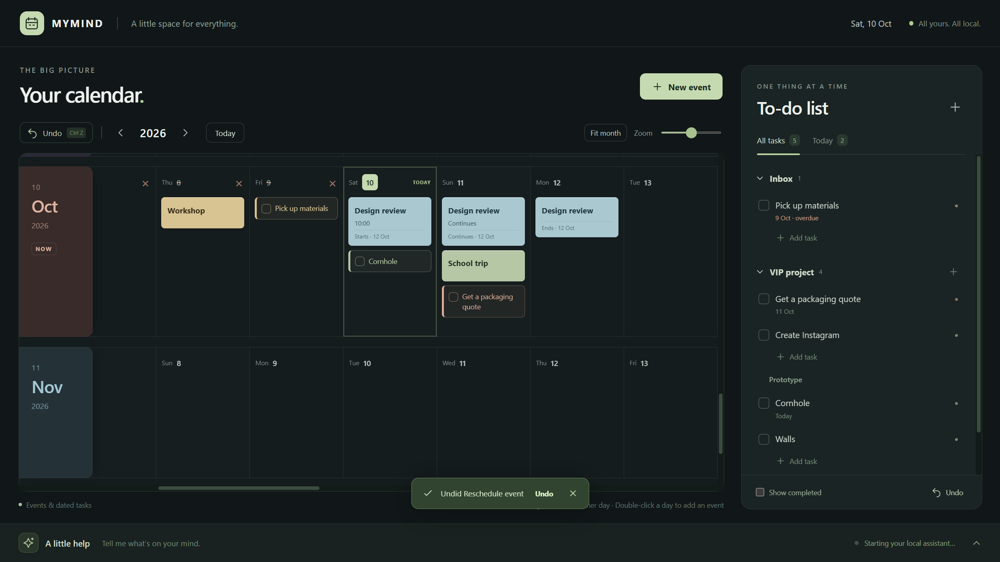
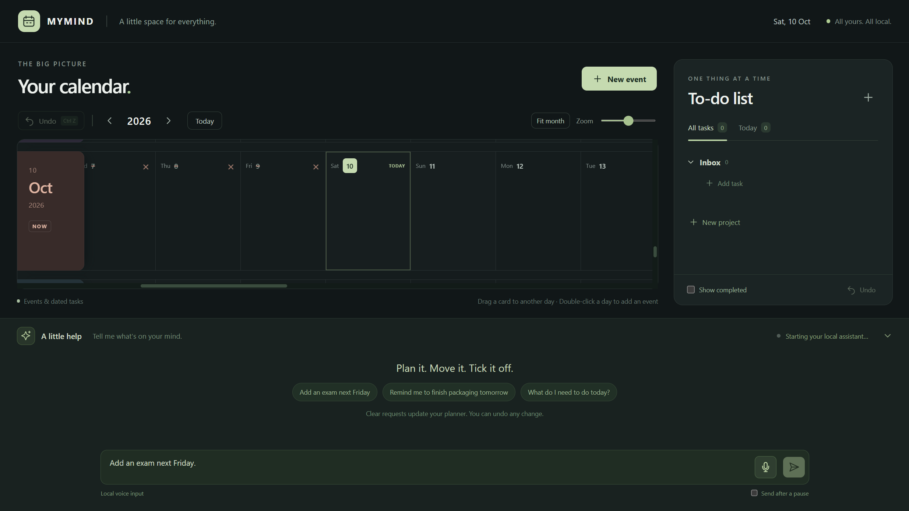
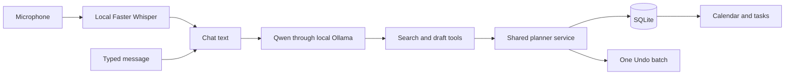

# MyMind

**A local Windows calendar and to-do app you can type or talk to.**

MyMind combines one horizontal calendar row per month, colored sticky-note-style events, and a project-based to-do list. Edit everything yourself or tell a small local model what to change. Voice input uses Faster Whisper; the planner assistant uses Ollama and `qwen3.5:4b`.

The central promise: **open it like a normal Windows app, use it, and close it completely.** Closing the window also stops the Ollama server, model runners, and dictation worker that MyMind started.

[Download the installer](https://github.com/opw-web/MyMind/releases) · [Product brief](docs/PRODUCT_BRIEF.md) · [Verification notes](VALIDATION.md)



## The original idea

The original workflow was a Miro board: each month occupied a long horizontal strip, individual days ran across it, past days were crossed out, and colored sticky notes marked events. A to-do list lived beside the calendar, with project headings and sections.

That arrangement made the month feel like a timeline. It was easy to glance across dates, place a note on a day, and keep practical work beside the calendar. The goal was to keep that useful structure in a purpose-built app with readable notes and simple controls. The screenshot was a reference for functionality, rather than a request to reproduce Miro's interface or build another infinite whiteboard.

The initial request had three priorities:

1. **A calendar and a to-do list that are easy to maintain.** Add events to dates, see days pass, organize tasks, and tick things off.
2. **A useful local assistant.** Tell it what needs doing, what has already been done, or what should move. Give it actual application tools so it updates the planner instead of merely describing changes.
3. **A proper desktop lifecycle.** A Start menu shortcut, a taskbar window, and a close button that quits the app and everything it launched. No leftover model occupying GPU memory after the window closes.

The first implementation delivered manual editing and typed requests. Version 1.1 adds the next part of the vision: a microphone beside Send, live local transcription inspired by Clicky's capture flow, and prominent toolbar and keyboard Undo.

## Calendar in month rows

- One horizontal strip per month, with weekday and date headers.
- Readable day cells, sticky month labels, scrolling, and zoom.
- **Fit month**, year navigation, and a **Today** button.
- Automatically crossed-out past dates; their contents remain readable and editable.
- Events with titles, notes, colors, dates, and optional start/end times.
- Single-day or multi-day events. A multi-day event appears on every covered date.
- Click a card to edit/delete it; double-click a date to create an event.
- Drag an event to reschedule it. Its duration is preserved, including when you drag a continuation card.
- Expand a day to inspect cards hidden behind the overflow count.

Dates use `Asia/Kolkata` by default. An event's inclusive end date is its last visible day. Times are local wall-clock times; untimed events do not receive an invented time.

## Tasks beside the calendar

- A right-hand to-do panel with projects, sections, and Inbox.
- Add, edit, delete, complete, and reopen tasks.
- Optional notes, colors, and due dates.
- Drag tasks to reorder them or move them between groups.
- A **Today** view with overdue tasks identified separately.
- A switch to show completed tasks.

**A dated task is one record shown in two places.** It appears as a checkbox card on its due date and in the to-do panel. Checking it in either view updates that same task. Changing its due date moves the calendar card.

Deleting a project or section returns its tasks to Inbox. It does not silently delete the work inside that heading. Undo restores the previous organization.

## An assistant that changes real data

The assistant can create, edit, move, recolor, and delete events. It can create, edit, delete, complete, reopen, and organize tasks. It can also create projects and sections, including a project → section → task hierarchy in one request.

```text
Add an exam next Friday.
Move it to Monday.
Delete the exam event.
Add a task called Buy notebooks, due tomorrow.
Mark Buy notebooks done.
Reopen Buy notebooks; I have not done it yet.
Delete the Buy notebooks task.
Create a project called School, a section called Homework,
and a task called Math worksheet in Homework due tomorrow.
What tasks are due tomorrow?
```

Clear requests apply automatically and show a summary of saved changes. If multiple items share a name, the app asks which one you mean. After “Mark Walls done,” for example, it can ask whether you mean the task in Inbox or VIP. “The one in VIP” continues the request.

This is a small local model: ambiguity and transcription mistakes are possible. The app validates its operations and provides Undo; it does not promise that every sentence will be understood perfectly. Check the change summary and correct or undo a change when needed.

## Voice input and a visible transcript

1. Expand **A little help**.
2. Click the microphone beside Send.
3. Speak. The microphone becomes a Stop control, an audio-level meter reacts, and the chat box shows live transcription drafts.
4. Stop speaking or click Stop. Faster Whisper performs a final transcription.
5. With **Send after a pause** enabled, the final transcript goes to the assistant automatically. Disable the switch to edit the text and press Send yourself.

The flow follows Clicky's local live-preview approach: previews roughly once a second and a separate final pass. It ends a turn after a sustained pause, stops an empty capture, and limits recordings to 45 seconds. Longer instructions can be split into several turns.

Cancel dictation while recording or transcribing to restore the text that was in the box beforehand. Partial transcripts are not sent. Collapsing the chat also stops capture. Closing or crashing the app terminates the dictation worker.

Faster Whisper uses the multilingual **base** model with CPU `int8` inference. This leaves GPU memory available for Qwen. The installer bundles the speech runtime and model, so dictation requires no Python installation, API key, or first-use model download. Audio stays in memory and goes only to the app's authenticated loopback worker; recordings are not saved.

Voice input is implemented. Spoken replies, wake words, and always-on listening are outside this version.



## Undo and keyboard controls

- **Undo** is visible in the upper-left calendar toolbar.
- **Ctrl+Z** undoes the latest planner change when working in the planner.
- After sending a request, Ctrl+Z also works with the now-empty chat box focused.
- In nonempty text fields, normal text-editing Undo takes precedence.
- One assistant request is one undoable batch, even if it changes multiple events, tasks, and headings.
- Undo history persists with the planner and retains the latest 50 batches.
- **Enter** sends a typed message; **Shift+Enter** adds a new line.

## Install

Requirements: Windows x64, a microphone for dictation, [Ollama](https://ollama.com/download/windows), and the [`qwen3.5:4b`](https://ollama.com/library/qwen3.5:4b) model downloaded locally.

If the planner model is not downloaded, install Ollama and run this once:

```powershell
ollama pull qwen3.5:4b
```

Download the **MSI installer** from [Releases](https://github.com/opw-web/MyMind/releases), run it, and open **MYMIND** from the Windows Start menu. The running window appears on the taskbar. Planner data lives separately from application files and survives updates.

The installed app needs no terminal, Node installation, Python installation, or development server. Those tools are only needed to build the source.

### Startup and GPU use

The calendar opens while the assistant starts in the background. Manual editing stays available during model loading or if Ollama is unavailable. Dictation starts its worker when you first use the microphone.

MyMind launches a dedicated hidden `ollama.exe serve` on an available loopback port, reuses your downloaded models, and disables cloud features for that process. It uses a 4,096-token context with one inference at a time. If model loading cannot fit fully in available GPU memory, it retries with a 2,048-token context. The status line identifies GPU, mixed GPU/CPU, or CPU use.

The development machine has an 8 GB RTX 5060 Laptop GPU. Real tests reported **100% GPU** for `qwen3.5:4b` at a 4,096-token context. Hardware, drivers, and other applications affect available memory and response time. The first request can take longer while the model warms up.

### What closing means

**Minimize keeps the app running. Close quits it.** This version has no tray mode or sign-in autostart.

MyMind owns the Ollama and speech workers it launches. Windows Job Objects group each worker with its children. Only the Electron main process holds their handles. Normal shutdown terminates the groups; force-killing the main process closes the handles and Windows terminates the workers too.

An independently running Ollama instance remains separate. MyMind does not terminate unrelated applications by matching process names.

## Data, privacy, and backups

```text
%LOCALAPPDATA%\MYMIND\planner.sqlite
```

Events, tasks, projects, sections, preferences, receipts, and Undo batches save locally. Completed changes save immediately. Chat context lives for the current app session rather than as a permanent conversation archive.

There is no MyMind account, subscription, cloud planner backend, or external inference API. Qwen uses local Ollama; Whisper uses an authenticated local worker. The renderer has no direct Node/filesystem access, and its network access is blocked. Microphone access is requested when you click the microphone.

To back up data, close MyMind and copy `%LOCALAPPDATA%\MYMIND`. Keep the SQLite file and any `-wal` / `-shm` companions together. Restore with the app closed. Updates and uninstallation preserve the data folder. Runtime error logs, if any, are in that folder; voice recordings are not.

The public repository contains source and synthetic fixtures. Personal databases, credentials, recordings, generated test profiles, build environments, and downloaded model weights are excluded from Git. Installers belong in GitHub Releases.

## How the assistant works



Manual controls and the assistant use the same service. The model has a small tool allowlist:

- **find_items:** search actual planner records and return IDs.
- **stage_changes:** validate a draft without saving. Multiple calls accumulate into one batch; repeated creates are deduplicated.
- **finish_request:** apply the complete draft, ask for clarification, or answer a question.

Project/section names resolve against existing records and items created in the same draft. The service validates titles, dates, time ranges, foreign keys, and protected Inbox behavior. It previews operations without saving, then commits the complete batch in a single SQLite transaction.

Revision checks prevent an old request from overwriting a planner changed while the model was thinking. Request IDs prevent duplicate application. Cancellation, invalid arguments, stale revisions, and timeouts leave the draft unapplied. Summaries come from committed database operations.

The model receives no arbitrary shell, filesystem, email, or desktop-control tools. Its job is the calendar and to-do list.

## Build from source

Developer requirements: Windows x64, Git, Node 22.13 or later, npm, Python 3.12, and Ollama with `qwen3.5:4b` for real-model checks.

```powershell
git clone https://github.com/opw-web/MyMind.git
cd MyMind
npm ci
python -m venv .speech-env
.speech-env\Scripts\python.exe -m pip install -r speech\requirements.txt
npm run build:speech
npm run icon
npm run typecheck
npm test
npm start
```

`build:speech` obtains the Faster Whisper base model through the normal Hugging Face cache, copies its required files into `speech-runtime`, and builds the standalone worker with PyInstaller. Model/package downloads occur during development; installed dictation uses local files only.

```powershell
npm run package
```

This produces `release/MYMIND-Setup-1.1.0.exe`. The pinned electron-builder wrapper preserves Windows environment variables for the temporary NSIS helper and can use the builder's own static uninstaller reader if Windows cannot spawn that helper. It changes no system security settings.

Build the Windows Installer package used by the release:

```powershell
npm run package:msi
```

This produces `release/MYMIND-Setup-1.1.0.msi`. On the development PC, application control blocked a rebuilt NSIS EXE, while standard Windows Installer successfully installed the MSI and its payload matched the latest build. The WiX build skips its administrator-dependent ICE validation because that validation service is unavailable under the local policy; the package is verified by actual installation and application tests. No system policy is disabled or changed.

| Directory | Purpose |
| --- | --- |
| `src/renderer` | Calendar, tasks, dialogs, chat and live dictation UI |
| `src/shared` | Types, validation and date helpers |
| `src/main` | Electron lifecycle, SQLite, assistant and worker ownership |
| `public` | AudioWorklet for microphone PCM capture |
| `speech` | Offline Whisper worker and build requirements |
| `scripts` | Speech build, icons, packaging and synthetic voice fixtures |
| `tests` | Data, desktop, model, voice and lifecycle checks |
| `docs` | Original product brief and synthetic-data screenshots |

The main process exposes a narrow typed preload API with context isolation and sandboxing. SQLite uses Electron's bundled Node runtime. Koffi supplies the native Windows Job Object calls. The speech worker bundles its Python runtime.

## Tests

```powershell
npm run typecheck
npm test
npm run build
npm run test:desktop
npm run test:model
node tests/model-crud.cjs
node tests/model-organization.cjs
powershell -NoProfile -File scripts/voice-fixture.ps1
node tests/speech-runtime.cjs
node tests/voice.cjs
npm run test:lifecycle
```

Checks cover leap years, date boundaries, rollback, foreign keys, Undo, duplicate-name clarification, staged-operation deduplication, new project/section references, manual editing, task/calendar synchronization, reopening saved data, real Qwen commands, live/final Whisper transcription, cancellation, keyboard Undo, and worker cleanup.

Voice tests use a locally synthesized WAV and Chromium's fake microphone input. They exercise capture → PCM → bundled Whisper → chat → planner without recording ambient audio. Check your chosen physical microphone and speaking environment too.

Set `MYMIND_TEST_EXECUTABLE` to an installed executable to test the packaged app. Fixtures stay under ignored `test-results` folders and never enter the user's planner. [VALIDATION.md](VALIDATION.md) records outcomes, including loading/inference shutdown, forced termination, port closure, and an independent Ollama server.

## Troubleshooting

| Symptom | Check |
| --- | --- |
| Assistant unavailable | Install Ollama and download `qwen3.5:4b`, then use **Retry assistant**. |
| Slow first request | Let the model warm up; check GPU/CPU status and other GPU-heavy apps. |
| Microphone blocked | Allow desktop-app microphone access in Windows privacy settings. |
| No input / wrong microphone | Check the default Windows input device and the audio-level meter. |
| Incorrect transcript | Disable **Send after a pause**, edit the text, and press Send. |
| Similar item names | Answer the clarification with a project, section or date, or edit manually. |
| Stale request | Send it again after the manual edit; the old draft was not applied. |
| Incorrect change | Use toolbar **Undo** or Ctrl+Z. Multi-part requests restore as one batch. |

## Scope and future work

MyMind is intended to stay focused: month rows, events, tasks, and local interaction. It is not a general Miro replacement or an autonomous operating-system agent.

Not implemented: recurring events, reminders/notifications, cloud sync, collaboration, Miro import, spoken replies, wake-word listening, or sign-in autostart. These are possible future additions, not advertised features of this release.

## Acknowledgments and licensing

The calendar arrangement came from the original Miro workflow. Clicky's local capture/live-preview design informed dictation. Dependencies include Electron, React, Vite, TypeScript, SQLite, Koffi, Ollama, Faster Whisper/CTranslate2, and the Whisper model.

The repository is public; no standalone project license has been selected, and the package uses `UNLICENSED`. Dependencies and models retain their upstream licenses. See [third-party notices](THIRD_PARTY_NOTICES.md).
